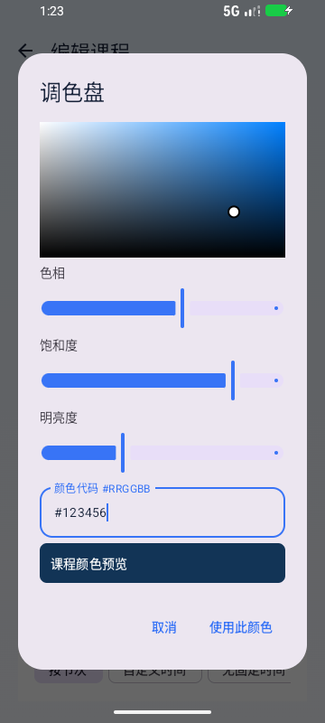
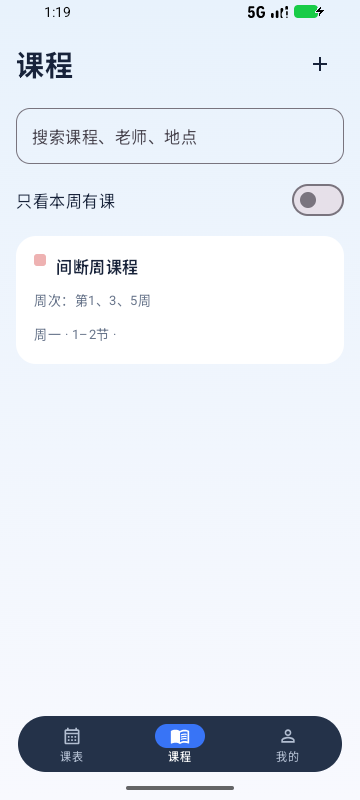
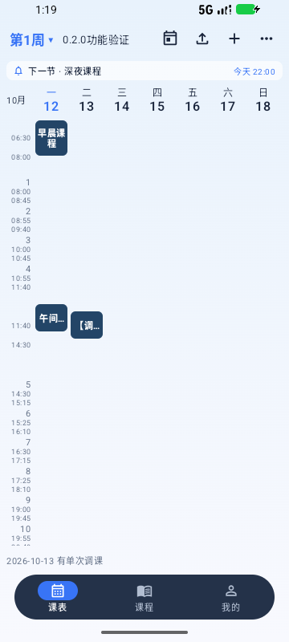
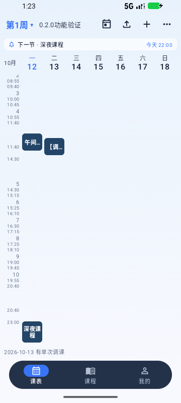
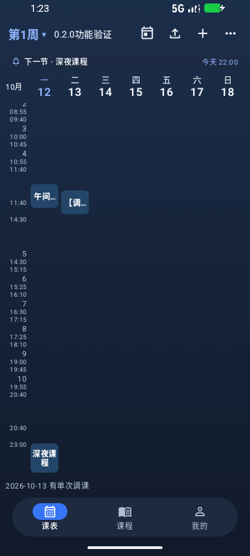
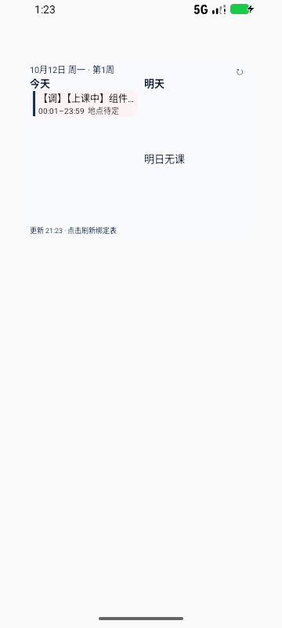

# van课表 0.2.0

日期：2026-10-12。versionName=0.2.0，versionCode=13。安装包使用本地 Debug 签名，可覆盖此前相同签名的本地安装包。

## 本次更新

| 需求 | 实现与使用方式 |
| --- | --- |
| 升级版本 | 应用和安装包版本为 0.2.0 |
| 空名称误加到上一门课、不能修改 | 空名称和纯空格名称直接提示错误，不写入课程。每次新增、编辑及快捷添加实验／考试使用独立草稿，保存或取消后清除该编辑草稿；再次编辑从最新课程读取。重建页面时仍保留尚未保存的内容 |
| 小组件空白也能打开课表 | 双日、今日及下一节组件的背景、无课区域均能打开绑定课表。列表按内容高度显示，课程下方空白可点击，长列表继续独立滚动；底部课表名称保留组件设置入口 |
| 进入后自动刷新 | 应用进入前台，以及打开课程详情时，都重新同步组件与下一次刷新安排；保存课程后的自动同步和课程开始／结束触发刷新保留 |
| 调色盘 | 编辑课程 → 打开调色盘。可点选或拖动颜色区域，调整色相、饱和度、明亮度，或填写六位颜色代码。任意不透明颜色在详情、网格、列表标记、组件色条、导出图片和备份中保持一致；深色背景自动使用浅色文字。原12个预设颜色保留 |
| 按周次和星期调课 | 我的 → 调课管理 → 按周次和星期，填写来源周次／星期及目标周次／星期，显示对应日期供核对。课程详情里的单次调整也可按目标周次／星期选择。非法周次或星期不保存 |
| 课程列表显示周次 | 每个重复上课时段显示周次，连续周合并为范围，间断周保持分段。例如“第1–3、5、7–8周”。单次课显示实际日期 |
| 快速回到今日／本周 | 课表顶部新增日历图标按钮：周视图回到本周，日视图回到今日。学期外仍提示学期未开始／已结束 |
| 自定义时间课落在网格外 | 自定义时间及改变了上课钟点的调课按实际起止时间投影到网格。占用午间／课间或作息之外的课程会增加相应时间区域，可在同一网格滚动查看；移除底部单独的自定义课程列表。原按节次课程继续使用节次行 |

整日调课沿用原有语义：目标日改上来源日的原课表，来源日仍保留原安排。如需移走来源日整天课程，再将来源日设置为停课。单次调课会移走原来的那一次课程。周次以当前课表的第1周周一计算，保存为具体日期，与原日期调整兼容。

## 验证

使用 Test Android Apps 的 Android Emulator QA 技能指导流程；实际构建和验证通过本地 Gradle、ADB、Compose 测试与 UiAutomator 执行。设备为 emulator-5556，Android API37、x86_64、360×800。小组件在真实 AppWidgetHost 中验证，截图来自实际界面。

| 检查 | 本轮最终结果 |
| --- | --- |
| Android模拟器 | 22项全部通过，0失败、0跳过，81.108秒。包含4项新增界面、2项新增组件、3项滑动／快捷课程、组件尺寸／滚动／绑定各1项、2项组件自动刷新、2项假期及学期、6项课程编辑和持久化回归 |
| 空名称与再次编辑 | 空名称保存前后Schedule完全一致；连续新增两门课ID独立，第一门课与时段保持不变；第二门修改后再打开读取最新名称 |
| 调色盘 | 色盘点选、颜色代码输入、保存、页面重建、备份回读、快捷实验课继承与图片导出通过。实际选用#123456，预览和详情可见浅色文字 |
| 周次与星期 | 间断周次显示“第1、3、5周”；来源第1周周一调整至目标第2周周三，核对保存日期及两天课程；第21周被拒绝，原调整不变 |
| 钟点布局 | 06:30–07:30、12:00–13:00、22:00–23:00课程，以及改至12:15–13:15的单次课程位于网格内。浅色／深色均检查，并实际滚动显示早晨、午间及深夜卡片 |
| 小组件点击 | 三种组件的无课区和背景均实点打开绑定课表，启用课表未被更改；有课程时点击列表下方空白同样进入课表。两列独立滚动及4×2尺寸课程完整显示回归通过 |
| 进入后刷新 | 用AppWidgetManager将组件更新文字暂改为旧标记，在不修改任何课表数据的情况下，进入应用、再进入课程详情分别触发更新；课程结束的真实闹钟自动移除也通过 |
| JVM单元检查 | 67项全部通过，0失败、0错误、0跳过。其中domain 64项、app 3项；包含5项新增领域检查与三份已有实际PDF兼容对照。PDF原件和识别正文留在本地测试目录，未装入应用 |
| 构建和静态检查 | Debug、Release、Android测试包构建成功；Lint 0错误、56警告。可安装交付包为Debug签名APK，Release产物为未签名构建，不用作安装交付 |
| 应用版本和崩溃 | 模拟器安装后确认versionName=0.2.0、versionCode=13；最终崩溃缓冲区为空 |

最终证据：[Android回归](test-evidence/0.2.0/android-final.txt)、[构建](test-evidence/0.2.0/build-final.txt)、[领域检查](test-evidence/0.2.0/domain-final.txt)、[单元结果](test-evidence/0.2.0/unit-summary.json)、[Lint](test-evidence/0.2.0/lint-final.txt)、[崩溃缓冲区](test-evidence/0.2.0/crash-final.txt)。

首次新增组件测试在返回已被系统重新创建的测试宿主时失败，改为每个点击位置单独创建宿主后通过。首次旧功能回归发现假期卡片同时设置两个testTag，导致原假期定位失效；改为每张卡片只设置一个唯一标记，保留原灰色卡片断言，最终22项全部通过。没有删除或放宽失败的灰色像素与可见性断言。

本轮未覆盖厂商桌面、厂商省电限制和 API26–30 的组件集合适配分支，不能将模拟器结果视为这些环境的真机结论。

## 截图

