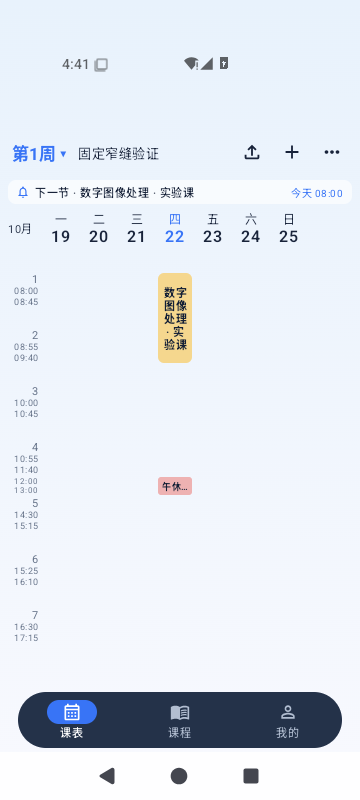
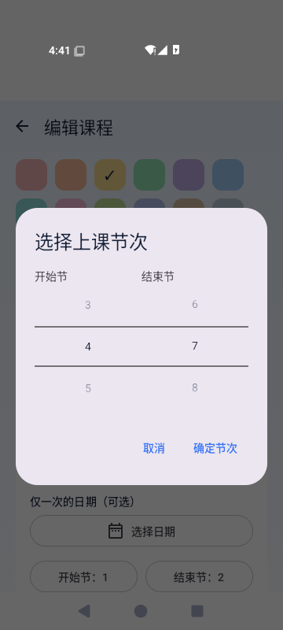
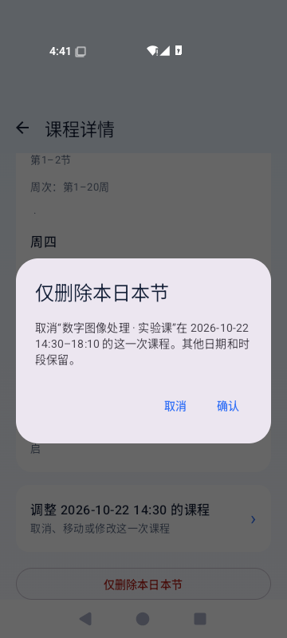

# 0.2.6 更新与验证

验证日期：2026-10-21 至 2026-10-22。包名 `app.van.timetable`，版本 `0.2.6`，versionCode `19`。

> 2026-10-22 签名问题已修复：使用用户提供的原版私钥重新构建，已在 Redmi K70 从原版 0.2.5 成功覆盖至 0.2.6，未卸载或清除数据。交付目录的 APK 已替换，新增“原签名修复”文件名便于区分之前不兼容的包。

## 实现

- 正常节次等高，课间及作息前后固定为 20dp 窄缝，并随字号缩放。自定义课程不再插入额外时间轴空间；跨节次课程按分段时间轴缩放。完全在空档中的课程显示单行，多个无冲突课程在同一空档并排显示，均可点开详情。
- 自定义时间标签开关保留，不参与布局高度计算。普通节次仍显示原始作息时间。大字号或内容过高时保留纵向滚动。
- 单次日期使用日历，可取消或清除；原本仅一次且没有周次的课程清除日期时默认采用整个学期周次，用户可继续修改。节次使用原生双列滚轮，确定才更新草稿，结束节不小于开始节。
- 详情页接收具体时段及原始日期，只取消点中的当天一整块课程；确认框显示课程、日期与时间。移动过的课程更新原取消键，其他时段与日期保留。无有效实例的假期和非本周预览不显示删除入口。
- 复用现有 `SessionOverride`，数据库仍为版本 1，备份字段未改变。保存后沿用现有 Scheduler 刷新小组件和提醒。
- 帮助与关于增加离线更新历史，按新到旧收录 README 已记载的用户功能说明；历史验证统计没有作为本次测试结果收录。
- 周网格预计算课程、冲突分组、非本周预览及卡片坐标；使用父布局已知尺寸绘制卡片，移除逐卡片 `BoxWithConstraints` 子组合。
- 取消整页透明度和缩放装饰，保留跟手横移、18% 短滑切周、松手吸附及按钮跳转动画。透明度小于 1 的图层可能引入离屏合成，设计依据见 [Android 官方图形修饰符文档](https://developer.android.com/develop/ui/compose/graphics/draw/modifiers#alpha)。

## 环境与构建

- Windows，Java 21.0.9，Gradle 9.3.1，Android SDK 平台 37.0，Build Tools 36.0.0。
- 专用 Android 16 / API 36 x86_64 模拟器 `emulator-5560`，360×800、160dpi。它不代表用户真机或厂商桌面的验收结果。
- 本机工具放在工程 `.tools/`，运行证据放在 `.verification/`，交付源码包不包含工具缓存、设备数据、密钥或构建缓存。
- 首轮 Debug、Release（未签名构建）和 Android 测试包构建成功。签名修复后再次成功构建 Debug、Release（已用原密钥签名）及 Android 测试包；实际交付和覆盖安装使用与原版相同证书的 Debug 包。
- 单元测试：domain 69 项、app 3 项，共 72 项通过，0 失败、0 跳过。导入解析脚本 11 项通过。
- Android Lint：0 错误，81 条警告；警告仍记录在本地 Lint 报告中，没有将其描述为零警告。

## 覆盖安装

保留未修改的 0.2.5 源码并使用本机已有 Debug 密钥构建。先在模拟器保存示例课表，再执行 `adb install -r` 覆盖至 0.2.6，没有卸载。

覆盖前后逐项比较 `schedules` 表的 ID、完整 JSON 课程数据与 DataStore 设置字节，结果一致。两个版本的签名证书 SHA-256 均为：

`76013fa323f763be8c7caa569dee23dfd27ab1af745fa0dd064c8b64f2f06385`

这是本机重建 0.2.5 至 0.2.6 的升级验证，仅证明两个本机 Debug 构建之间的数据保留行为。它不能证明可覆盖 GitHub 原版。

2026-10-22 通过 ADB 只读取得手机已安装 0.2.5 APK，并下载 GitHub v0.2.5 发布 APK，使用 Android Build Tools `apksigner verify --print-certs` 复核。二者的签名证书 SHA-256 均为：

`2787e9a025cbd6606ac2ec05415432513ada6732360ce4dc2abb22e049e938bf`

该证书与首轮 0.2.6 的 `76013f…f06385` 不同，解释了用户报告的安装错误 -7。原版发布来源：[GitHub v0.2.5](https://github.com/vanvan-program/van-/releases/tag/v0.2.5)。首轮不兼容 APK 的 SHA-256 为 `8ce2544c5087cdf51fdaebac2931081ccbbf5248955ab92346e03a419e5bf4e3`，请使用下述修复包。

用户随后提供原版密钥。已验证包含私钥，证书指纹与手机、GitHub 原版一致；新增私有 `signing.properties` 配置，并在 Gradle 中核对原版指纹，配置错误时终止构建。密钥、配置及原始说明均排除在交付源码外。修复包的非 `META-INF/` ZIP 条目与首轮已测试 APK 逐项 SHA-256 完全一致，应用代码、资源、清单及版本未改变，仅修复签名。本轮没有重跑之前的完整交互测试或性能采样，不将旧记录表述为重新验证。

经用户明确授权，先停止旧版并将完整应用数据保存到本机私有 `.verification/private-phone-signature-20261022/old025-app-data.tar`（10,652,160 字节），数据库完整性检查通过，再执行 `adb install -r`。Redmi K70 / 23113RKC6C 返回 `Success`，安装版本为 0.2.6；未卸载、清空或恢复覆盖数据。升级后 2 份课表的 ID 和完整 JSON 与原备份一致，数据库完整性通过。

首次备份至升级后采样期间，设置中仅 `activeScheduleId`（当前启用课表）发生变化，原因未确定，未擅自将旧值写回。其他设置字段一致。为排除采样间隔的影响，随后紧邻采样执行“停止进程 → 当前状态快照 → 同一 APK 覆盖 → 停止进程 → 状态快照”：全部课表及设置原始字节一致。该复核属于 0.2.6 同包覆盖，不冒充首次升级时设置字节完全一致的结果。

应用启动成功，3 秒后进程仍在，无该进程的 `FATAL EXCEPTION`，已确认真机课表界面正常打开。私有原件与真机截图只保留本机，不进入源码或公开证据。签名与覆盖记录见 [原版签名对比](0.2.6证据/原版签名对比.txt) 和 [真机覆盖记录](0.2.6证据/原签名真机覆盖.txt)。

## 交互验证

最终交付 APK 在 Android 16 / API 36 的 15 项相关交互回归全部通过，90.763 秒，0 失败、0 跳过。另在 Android 15 / API 35 复核全部 6 项新增功能，结果见独立日志。

- 新增 6 项：固定窄缝跨周稳定及标签开关；日历选择与清除、两个滚轮真实滑动、取消和页面重建；当天指定整块删除及确认取消；移动课程按原始日期删除；假期预览不提供删除及离线历史；作息前后、午休多个小卡片并排和跨课间课程点击。
- 原有 6 项分页测试：拖动跟手与吸附、短滑切一周、首尾边界与回到今天、课程实例日期、跨学期日列表、重建与模式切换。
- 3 项相关回归：快速交替滑动与大字号网格、重复外部入口及后台恢复、真实 AppWidgetHost 中点击课程返回绑定课表。
- 单次取消域测试覆盖其他日期和同日其他时段保留、重复取消去重、移动后的原日期不复活、整日替换、单次钟点课及备份往返。

测试修正记录：日历按完整日期语义定位；原生滚轮通过 Compose 宿主节点实际发送滑动；小组件测试使用已有串行 Scheduler 刷新路径，避免直接刷新与初始化广播竞争。早期失败与中断记录保留在本机 `.verification/`，不计作通过。

## 性能对比

最终比较环境：同一 Android 15 / API 35 AOSP x86_64 专用模拟器，原生 360×800、160dpi、2GB 内存、SwiftShader 图形后端。两版均为 Debug，固定 35 门课程、35 个时段、20 周，浅色、默认字号、显示周末、适配整周。每版预热 4 组双向切周，随后测 3 轮，每轮 8 组双向切周（16 次滑动），每次均确认周次切换正确。

两版使用相同数据和显示设置，版本本身的时间轴及动画效果有变化，因此这里比较的是整体版本表现，不能把差异全部归因于某一个缓存或绘制改动。性能采集时没有并行编译。

| 版本／轮次 | 帧数 | Janky frames | P95 | P99 |
| --- | ---: | ---: | ---: | ---: |
| 0.2.5／1 | 912 | 90.13% | 61ms | 150ms |
| 0.2.5／2 | 912 | 88.49% | 57ms | 150ms |
| 0.2.5／3 | 912 | 91.89% | 61ms | 150ms |
| 0.2.6／1 | 917 | 89.86% | 85ms | 121ms |
| 0.2.6／2 | 917 | 84.19% | 61ms | 85ms |
| 0.2.6／3 | 919 | 79.43% | 61ms | 77ms |

三轮中位数：P95 从 61ms 到 61ms；P99 从 150ms 到 85ms；卡顿比例从 90.13% 到 84.19%。绝对卡顿比例仍然很高，这些数字只描述本次软件渲染模拟器样本，不能据此宣称真机已经消除卡顿。

初轮与编译重叠的数据未用于最终比较。Android 16 Google APIs 镜像长时间压测中曾观察到约 600MB 交换内存，并在后续运行中出现模拟器与 ADB 一起失去响应，因此其压力轮次、候选包统计及超时均单独保留，不与最终 Android 15 结果混用。候选版仅改善长帧而未改善卡顿比例时，进一步移除了整页透明度和缩放装饰。最终代码在 API 36 完整回归通过后，使用更轻量的 API 35 AOSP 镜像重新测量两版及复核新功能。没有把失败或候选包数据当最终包结果。

使用 Android Performance 和 Android Emulator QA 流程。Perfetto 每次记录 30 秒，包含应用主线程、调度和图形事件；切片耗时是包含框架调用的墙钟时间，不是某函数的独占 CPU 时间。完整轨迹保留在本机 `.verification/controlled-performance/`，摘要与帧原始统计见 [验证证据](0.2.6证据/性能统计.json)。

## 实际截图

[日历选择](0.2.6证据/截图/026-calendar.png) · [深色与大字号](0.2.6证据/截图/026-dark-large-grid.png) · [空档课程并排](0.2.6证据/截图/026-gap-cards.png) · [离线更新历史](0.2.6证据/截图/026-changelog.png)

## 交付

- 安装包：`deliverables/van课表-0.2.6-原签名修复.apk`，与 `van课表-0.2.6.apk` 内容相同，使用原版 Android Debug 证书，54,213,575 字节。
- 安装包 SHA-256：`06e3690997eee4d2ad8c19d209613e474d8cb587ca45a95fa116c959f9f00f73`。
- 源码：`deliverables/van课表-0.2.6-源码.zip`，含验证文档与脱敏合成截图，不包含 SDK、构建缓存、设备数据库或签名密钥。
- 两个 APK 文件名及源码 ZIP 的 SHA-256 一并记录于 `deliverables/SHA256SUMS.txt`。

## 真机验证边界

模拟器验证不替代实际手机触摸流畅度、厂商桌面小组件、后台省电和提醒准时性的核对。本次未变更教务解析协议，也未重新登录真实学校网站。原签名修复包已完成真机覆盖安装、课表内容比对及启动检查；本轮真机验证不包含长时间提醒、小组件或性能测试。
