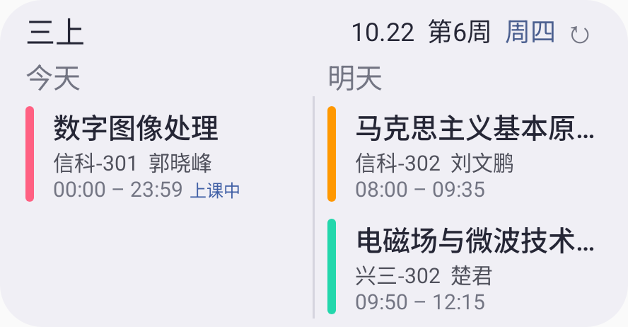
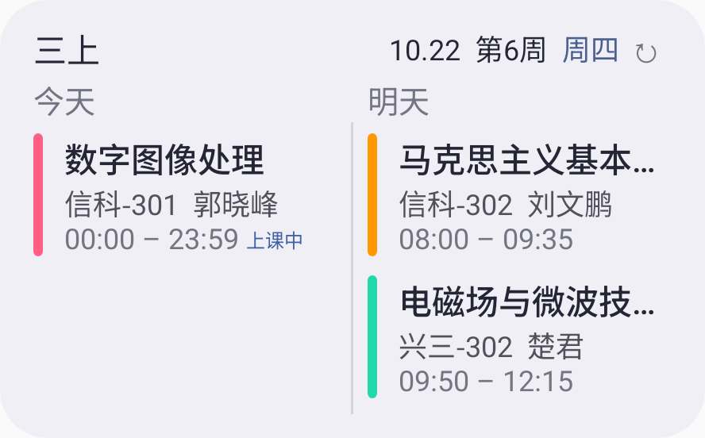
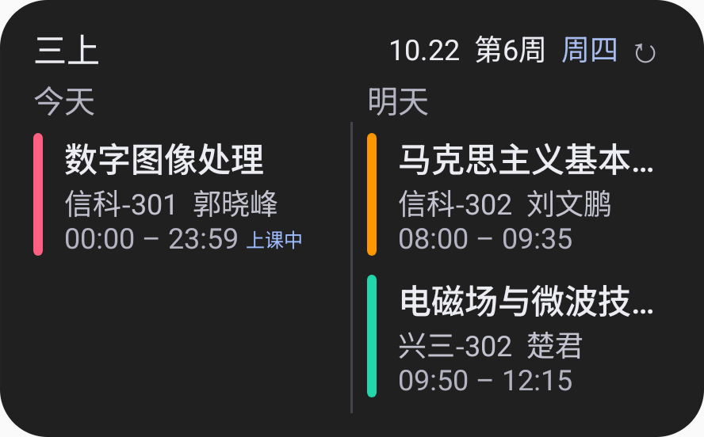

# 0.2.7 小组件外观优化与验证

日期：2026-10-22。包名 `app.van.timetable`，versionName `0.2.7`，versionCode `20`。

用户先确认设计预览，再授权写入更新。本次主要调整今日／双日小组件的外观。

## 外观与适配

- 保留浅灰紫与深灰背景，调整内边距、课程间距和文字层级；课表名使用主要文字颜色，星期使用蓝色强调。
- 课程名称使用中等字重，地点／教师与时间分级显示；长名称、地点单行省略，时间保留完整。
- 课程色条使用圆头；通过小尺寸透明位图兼容 API 26+ 的 RemoteViews，保留自定义颜色。默认色条取对应浅／深课程色板。
- 隐藏今日／双日组件底部更新时间；点击课表名仍可进入组件设置，右上保留手动刷新。
- 按宿主报告的可用高度选择三行或两行排版；可用高度达到 180dp 时增加留白和字号，最矮尺寸优先保留两节课程。
- “上课中”独立显示，三行布局放在时间旁，避免挤占课程名；两行布局保留原有状态位置。
- 每次更新显式重置自适应边距、字号和课程行内边距，避免宿主复用布局时残留上一次尺寸的样式。
- 保留两列独立滚动、课程点击、空白点击、多课表绑定与自动刷新。数据库和备份格式未变更。
- 帮助与关于的离线更新历史新增 0.2.7，默认展开本版本。

## 验证环境与记录

专用模拟器 `van027` / `emulator-5564`，Android 15 / API 35，x86_64，软件图形后端。测试均使用合成课表，未操作用户手机。

首轮发现宿主复用时保留大尺寸的边距与字号，以及中文字体行高叠加后第二节课程被裁切。已修正样式重置并缩减中等高度的课程间距。高密度复核另发现最矮尺寸有 1 像素裁切，缩减标题下间距补足余量；保留完整可见性断言。

测试宿主原先使用固定像素边距，切换像素密度后与系统状态栏发生重叠，已统一为 dp。截图等待当前布局进入显示帧，并核对截图背景像素与主题一致；点击测试等待课程项实际布局完成。上述测试宿主仅用于本地 Android 测试，不进入 Release 变体。早期失败日志仅留在本机 `.verification/`，不计为通过。

| 检查 | 结果 |
| --- | --- |
| 离线构建 | Debug、Release、Android 测试包成功 |
| 单元测试 | domain 69 项、app 3 项，共 72 项通过，0 失败、0 跳过 |
| 最终小组件回归 | 1080×2400、480dpi，8 项通过，70.283 秒，无失败或跳过 |
| 常规像素密度阶段回归 | 360×800、160dpi，8 项通过，61.232 秒；之后仅补足紧凑布局余量并修正测试宿主与等待条件 |
| 尺寸 | 两种主题下依次检查 170、130、110、200、170、130dp 宿主高度；每列前两节课完整显示，课程名、时间和地点的文字行不裁切，时间不省略 |
| 视觉 | 三行信息顺序、教师信息、长名称省略、自定义色条颜色与圆头透明角落、主题与隐藏底栏通过 |
| 交互 | 两列独立滚动、多课表独立绑定、课程点击、三种组件空白点击、隐藏底栏后的设置入口通过 |
| 自动刷新 | 保存、假期变更自动同步；真实课程结束闹钟移除课程；应用及课程入口刷新通过 |
| Lint | 0 错误、76 条警告，保留小字号、硬编码文案等警告，不表述为零警告 |
| 覆盖升级 | 原签名 0.2.6 → 最终 0.2.7，4 份合成课表的完整 JSON 和所有设置字节一致 |
| 崩溃缓冲区 | 为空 |
| 交付一致性 | 从模拟器拉取实际测试 APK，与交付构建的 SHA-256 完全一致 |

最终原始记录见 [高密度小组件测试](0.2.7证据/Android高密度小组件测试.txt)、[尺寸测量](0.2.7证据/高密度尺寸测量.txt) 和 [覆盖升级](0.2.7证据/覆盖升级验证.txt)。

## 实际截图

以下为原生 AppWidgetHost 的真实屏幕像素裁剪，不是设计生成图。使用合成课表，其中今日课程设为全天，以稳定展示“上课中”。

[用户已确认的设计预览](0.2.7证据/已确认设计预览.png) 用于记录外观方向，与上述实测图片区分。

## 覆盖升级与签名

在独立模拟器先安装交付目录的原签名 0.2.6，保存示例课表，再使用 `adb install -r` 覆盖至 0.2.7。未卸载或清除数据；升级前后数据库完整性检查通过，课表 ID、完整课程 JSON 与 DataStore 设置原始字节一致。

0.2.7 沿用原版证书，SHA-256 指纹：

`2787e9a025cbd6606ac2ec05415432513ada6732360ce4dc2abb22e049e938bf`

工程继续使用私有签名配置及原版指纹校验。源码包不包含密钥、密码配置、设备数据、工具或构建缓存。交付 APK 沿用前版本的 Debug 构建方式；Release 变体也完成构建。

## 交付

- 安装包：`deliverables/van课表-0.2.7.apk`，54,711,468 字节。
- APK SHA-256：`870a2cfb3248cfbba110039f8eaf762f99d720a761c702bc2a821cf5fa671784`。
- 可重建源码：`deliverables/van课表-0.2.7-源码.zip`，含本次验证文档、合成截图与测试源码。
- 安装包及源码校验值：`deliverables/SHA256SUMS-0.2.7.txt`。

## 验证边界

设计预览用于确认风格，实际 Android 排版会按组件尺寸省略长文字。实际截图中的日期、周次与课程状态来自测试时刻和合成课表。

本轮未在用户真机、厂商桌面或 API 26–30 系统上执行；模拟器截图与覆盖验证不能等同于这些环境的验收结果。未重新测试教务登录、导入协议、提醒在厂商省电策略下的准时性或课表分页性能。
