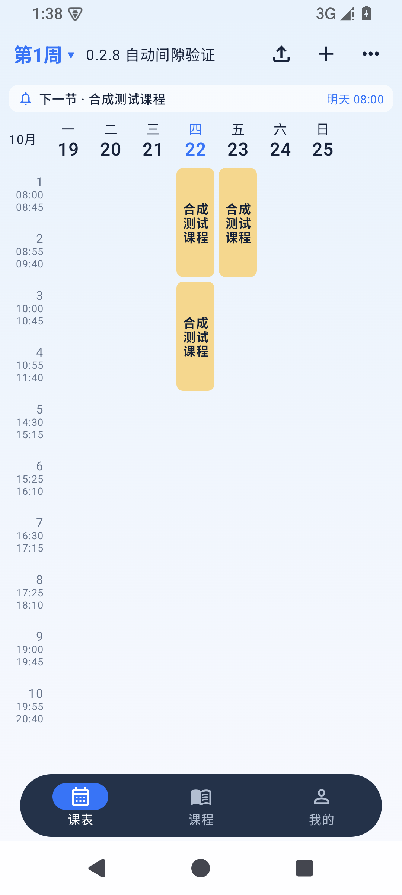
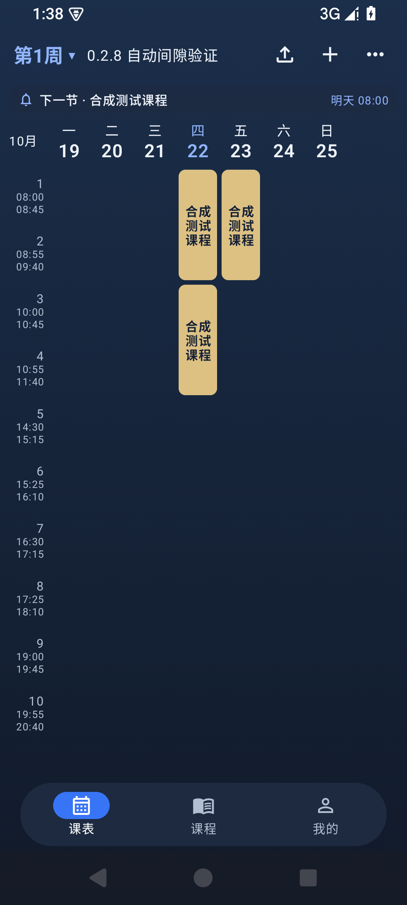
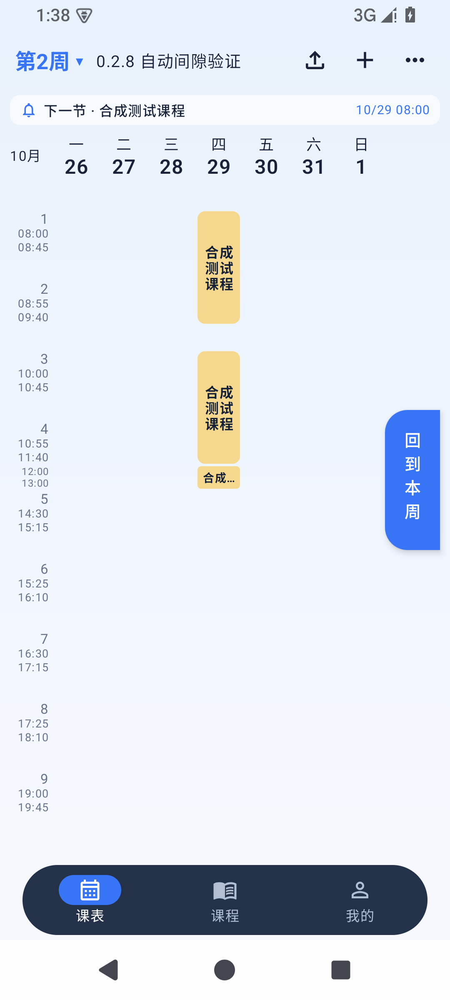

# 0.2.8 布局自动切换与圆角修正

日期：2026-10-22。包名 `app.van.timetable`，versionName `0.2.8`，versionCode `22`。

## 修正内容

根据用户反馈，撤销初版把课程拼成直角色块的处理。课程卡片始终保留圆角矩形和小间距；自动判断只决定是否保留时间轴上的课间空档。

| 课表情况 | 默认显示 |
| --- | --- |
| 全部课程时间均位于作息节次内 | 采用 0.2.5 的紧凑节次布局：每节课保持一行，收起课间及作息前后的时间空档；普通卡片使用 6dp 圆角，左右各 2dp、上下各 2dp 留白 |
| 存在占用课前、午休、课后等空档的课程 | 采用 0.2.6 的固定空档时间轴：空档高度为 20dp × 字体缩放，卡片左右各 2dp、上下各 1dp 留白；普通卡片使用 6dp 圆角，空档小卡片使用 3dp 圆角 |

对照本机保存的 0.2.5 源码，核对了时间轴、行高适配、圆角和卡片边距。本次保留当前的课程计算与分页实现，不回退旧版代码。

连续多节课程可以跨越节次之间的休息时间，但开始和结束需分别位于上课节次内。未排课的节次始终保留。

自动判断覆盖整张课表的全部周次、周末、单次课程、调课、假期预览及非本周灰色课程，切换周次或隐藏周末不会改变布局策略。多作息日期规则按当前周网格实际采用的共享时间轴检查，无法安全收起空档时保留空档。

外观设置中的开关更名为“保留课间时间空档”，可以手动选择或恢复自动判断。即使旧设置保存为关闭，卡片也保持圆角和小间距；有空档课程时仍保护其显示空间。

数据库、课程时间、日列表、小组件和提醒计算不变。自动、手动开启、手动关闭三种偏好仍支持完整备份恢复。

## 验证

按 Android Emulator QA 技能在专用模拟器 `van027` / `emulator-5564` 验证：Android 15 / API 35，x86_64；1080×2400、480dpi。仅使用合成课表，未操作用户手机。

界面测试针对用户反馈增加截图像素检查：卡片角落显示页面背景、顶边中部显示卡片颜色，防止再次出现直角色块。并按像素密度核对普通课表中横向、纵向各 4dp 的卡片间距，以及有空档课程时 20dp 的时间轴空档。

| 检查 | 修正版最终结果 |
| --- | --- |
| 离线构建 | Debug、Release、Android 测试包成功 |
| 单元测试 | domain 78 项、app 3 项，共 81 项通过，0 失败、0 跳过 |
| 模拟器界面回归 | 6 项通过，19.016 秒，无失败 |
| 形状与布局 | 浅色、深色的圆角像素检查及 0.2.5 卡片边距通过；0.2.6 空档、后续周次、切周稳定性、旧手动关闭设置及课程点击通过 |
| Lint | 0 错误、77 条警告 |
| 覆盖升级 | 0.2.8 code 21 → code 22，6 份课表完整 JSON 和设置原始字节一致，数据库完整性检查通过 |
| 安装包一致性 | 从模拟器拉取的实际 APK 与交付构建 SHA-256 一致 |
| 崩溃缓冲区 | 为空 |

原始记录见 [界面测试](0.2.8证据/界面测试.txt)、[单元测试](0.2.8证据/单元测试.txt)、[覆盖升级](0.2.8证据/覆盖升级.txt)、[安装包一致性](0.2.8证据/安装包一致性.txt) 和 [Lint](0.2.8证据/Lint.txt)。

以下为修正版实际截图，已替换初版的错误直角色块截图：

## 覆盖升级与签名

版本仍为 0.2.8，内部 versionCode 从 21 提高到 22，便于覆盖修正前的安装包。验证采用 `adb install -r` 直接覆盖，不卸载或清除数据；比较前后的完整课程 JSON 和 DataStore 设置原始字节。

沿用原版签名证书 SHA-256：

`2787e9a025cbd6606ac2ec05415432513ada6732360ce4dc2abb22e049e938bf`

## 交付与边界

- 安装包：`deliverables/van课表-0.2.8-圆角修正版.apk`，同时更新 `deliverables/van课表-0.2.8.apk` 为同一内容。
- 可重建源码：`deliverables/van课表-0.2.8-源码.zip`。
- SHA-256：`deliverables/SHA256SUMS-0.2.8.txt`。

APK 大小：54,230,919 字节。APK SHA-256：

`b1f34cef97ec11c9acea2db89e147e0871be535271fff63520347ef2207a114b`

源码包排除签名密钥、密码配置、设备数据库、工具、缓存和私有原件。修正前的错误包仅保留在本机 `.verification/028-before-correction/`，不作为交付。

本轮未在用户真机或其他 Android 版本上验证，未重测教务登录、导入协议、桌面组件外观或厂商后台提醒。
