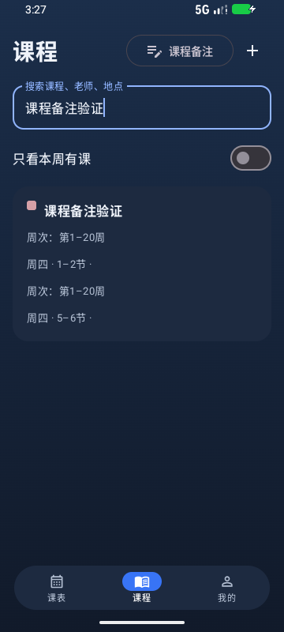
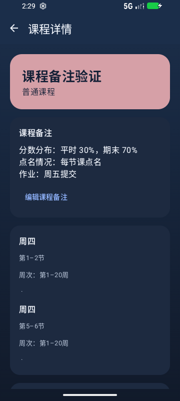

# 0.2.9 课程备注

日期：2026-10-22。基于 GitHub main 的 `2bd5c1b`（0.2.8）实现。

## 使用

进入底部“课程”页，点击右上方唯一的“课程备注”按钮，即可集中查看当前课表全部课程的备注。没有填写的课程显示“暂无备注”，可在汇总页添加或编辑。课程列表中的搜索和“只看本周有课”不会过滤汇总页。

已填写非空备注的课程优先显示，未填写的排在后面；每组内保持课表原有顺序。保存或清空备注后自动重新排序，只有空白字符的备注按未填写处理。

点击课程进入详情后也能添加或编辑备注。可多行记录，例如：

```
分数分布：平时 30%，期末 70%
点名情况：每节课点名
作业：周五提交
```

点击“保存备注”后显示在课程详情顶部；取消不保存，留空保存可清除。编辑整门课程时也能修改同一备注。详情正文可长按选择复制。

复用已有 `Course.note` 字段，同一课程的全部上课时段共用；旧备注、数据库结构和完整备份格式保持兼容。单独保存备注时读取最新课表，仅修改指定课程的备注，保留其他课程、时段和调课信息。

## 验证范围

- 包名 `app.van.timetable`，版本 0.2.9，versionCode 26，Debug 构建。
- 发布前核对 domain 78 项、app 3 项单元测试，0 失败、0 跳过；另有 11 项教务导入解析脚本测试通过。
- Debug 安装包和 Android 测试包离线构建通过；Lint 0 错误、76 条警告。
- 专用模拟器 `emulator-5556`，Android API 37，360×800、160dpi。
- 汇总页上一轮四项界面测试全部通过，15.657 秒，0 失败。覆盖：唯一汇总按钮、搜索后仍显示所有课程、空备注占位与已有备注、汇总页编辑和页面重建、其他课程备注保留、普通卡片进入详情；以及中文多行输入、备份恢复、取消和清空、完整课程编辑页互通。
- 本轮排序改动通过 1 项相关端到端测试，11.03 秒，0 失败：已有备注优先、首次保存后同组保持原顺序、清空后归入未填写组、再次保存、编辑草稿重建及搜索不影响汇总。未重复其他三个界面测试。记录见 [备注排序测试](0.2.9证据/备注排序测试.txt)。
- 初次测试在返回课程列表后同时匹配到搜索框文字与同名课程卡片，修正为明确定位可点击的课程卡片；应用代码未为此改动。
- 最终检查崩溃缓冲区为空；使用合成课程，未操作用户手机。
- APK 原版证书 SHA-256：`2787e9a025cbd6606ac2ec05415432513ada6732360ce4dc2abb22e049e938bf`，证书类型 Android Debug。
- APK SHA-256：`3036538976837f56c6e59cc90259309ea64ec8ee96f68de4f541ec51411c33d8`。

原始交互结果见 [界面测试](0.2.9证据/界面测试.txt)。






## 交付

发布附件：`van-timetable-0.2.9.apk`、`van-timetable-0.2.9-source.zip` 与 `SHA256SUMS.txt`。安装包与已测试的本地交付包一致，源码 ZIP 来自本次 Git 提交。

本次完成实现和模拟器验证，未在用户真机覆盖安装，未重测教务登录、导入、小组件或后台提醒。附件不包含签名密钥、本机配置、工具缓存或私人课表原件；验证截图均为合成课程。
