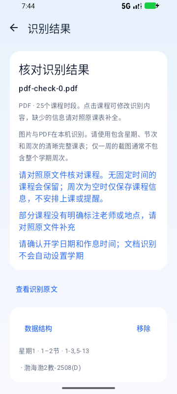
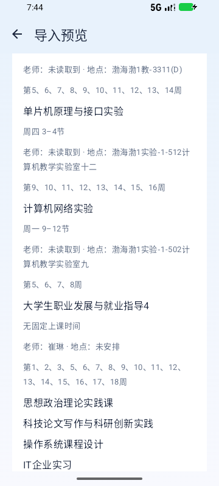
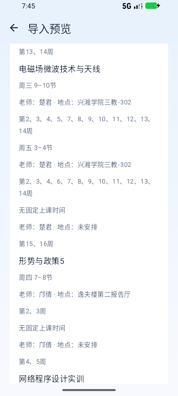
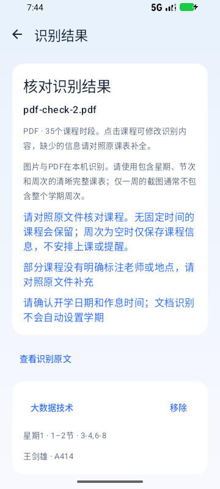
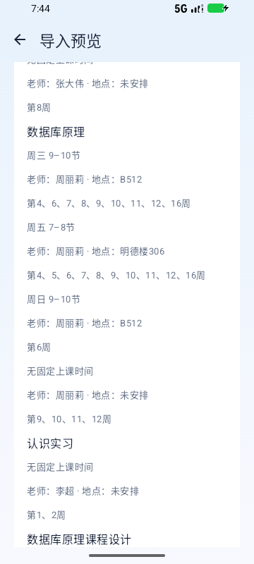

# 三份实际PDF兼容复核

日期：2026-10-12。检查版本：0.1.11-local（versionCode=12）。结论：当前版本仍支持这三份实际文件；本轮无需修改应用解析器。

| 脱敏样本编号 | 页数 | 常规时段 | 时间未定课程 | 保存结果 |
| --- | --- | --- | --- | --- |
| 样本 A（sample-0） | 2 | 20 | 5 | 16门课程，21个时段；其中4门未注明周次，仅保留课程信息与老师备注 |
| 样本 B（sample-1） | 1 | 13 | 7 | 8门课程，20个时段，老师、地点和页脚课程保留 |
| 样本 C（sample-2） | 3 | 26 | 9 | 12门课程，35个时段，跨页课程、单双周与实践课程保留 |

公开文档仅使用样本编号，原文件名、学生身份和本机路径已移除；三份原PDF不随仓库分发。

本轮逐页渲染检查了全部6页原文件，设置VAN_PDF_SAMPLES后运行实际样本检查，JVM共62项全部通过，0失败、0跳过。此前未提供参数而跳过的实际PDF检查本轮已执行。

通过Test Android Apps的Android Emulator QA流程，在API37 / x86_64 / emulator-5556 / 360×800模拟器上运行当前0.1.11应用。4项PDF设备测试全部通过，0失败、0跳过，20.021秒：1项从真实Android文件URI读取三份样本并保存回读；3项分别通过实际文件选择回调、识别核对、学期与作息预览、保存新课表和备份恢复。未用合成PDF代替这些文件。

具体核对包括：

- 第一份的两页续表、概率论单周、计算机网络实验重复绘制去重并保留9—12节范围；4门无周次课程不生成上课或提醒，教师仍保留在课程备注中。
- 第二份数字图像处理周四9—10节的老师、信息科技大楼北-301地点与分段周次，以及实践／其它课程。
- 第三份数据库原理的4—6双周、7—12周和16周，B512地点，课程设计第18周，以及全部9项无固定时间课程。
- 每份保存后原有课表、原启用状态保持；完整备份回读一致。预览中的无固定时间课程不显示猜测的默认钟点。

第一份原文未提供常规课程老师和部分地点，4门时间未定课程也未注明周次；这些信息需要按学校安排补充。三份文件均没有完整的学校钟点作息或明确的第1周周一，导入时仍应核对。测试中的2026-08-31仅用于验证日期保存，不作为学校开学日期结论。

最终崩溃缓冲区为空。三份原件的SHA-256与检查前一致。测试副本使用sample-0／1／2名称，截图展示导入界面，不包含原PDF学生身份页；原件没有进入应用安装包或源码包。临时渲染、提取文字和模拟器PDF副本在验证后清理。

本轮证据：[实际PDF核心检查](test-evidence/pdf-compat-core.xml)、[Android最终日志](test-evidence/pdf-compat-android.txt)、[崩溃缓冲区](test-evidence/pdf-compat-crash.txt)。构建日志保存在上级.tools的gradle-pdf-compat-0.1.11.log和gradle-pdf-ui-0.1.11.log。新增LocalPdfFlowTest可重跑实际文件的界面验证；需要先提供三个sample文件，未提供时跳过。

